### Hi, I'm Kerem 👋

I'm a university student. I build iOS apps and web projects alongside school.

🌐 Portfolio: **[kerem-sahin.github.io](https://kerem-sahin.github.io)**

**Open source**

- **[PlainParse](https://github.com/kerem-sahin/plainparse)**: turns one plain sentence into a task, in Turkish or English. `Cuma fizyoloji ödevi 18:00` → title, day, time, repeat. Swift, no dependencies, 150 tests. The engine behind plainday's quick-add bar.

**Apps**

<table>
  <tr>
    <td width="76" valign="top"><a href="https://apps.apple.com/tr/app/here/id6767262061">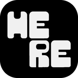</a></td>
    <td valign="top">
      <b><a href="https://apps.apple.com/tr/app/here/id6767262061">here.</a></b> · <i>on the App Store</i> 
      See who's at the same venue right now and meet them. Polygon geofencing for malls and campuses, tested in real venues in Konya. 
      React · Capacitor · Firebase 
       
      

Screenshots
 
        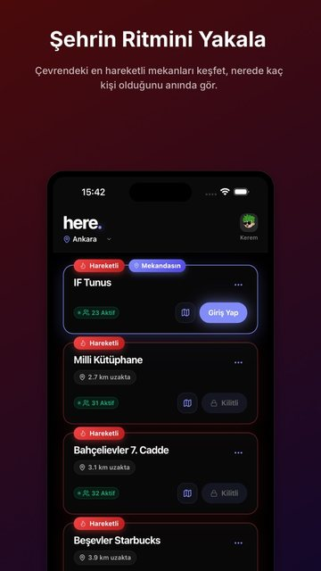
        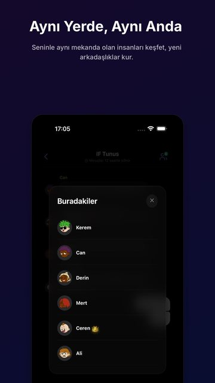
        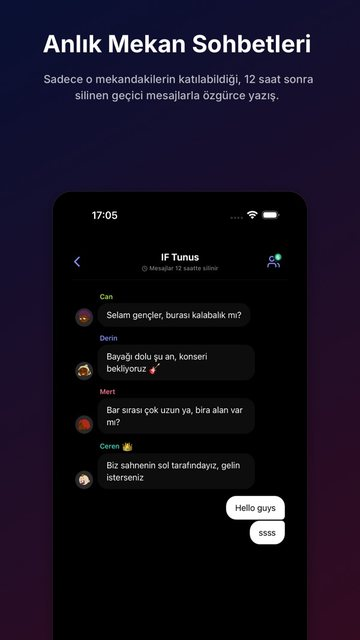
        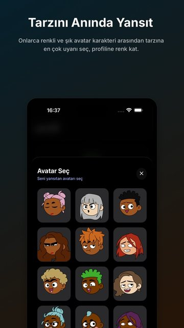
      

    </td>
  </tr>
  <tr>
    <td width="76" valign="top"><a href="https://apps.apple.com/tr/app/notecook/id6811676558">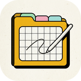</a></td>
    <td valign="top">
      <b><a href="https://apps.apple.com/tr/app/notecook/id6811676558">notecook</a></b> · <i>on the App Store</i> 
      Handwriting notebook for iPad and Apple Pencil, with searchable handwriting and PDF annotation. 
      SwiftUI · PencilKit · Vision · SwiftData + CloudKit 
       
      

Screenshots
 
        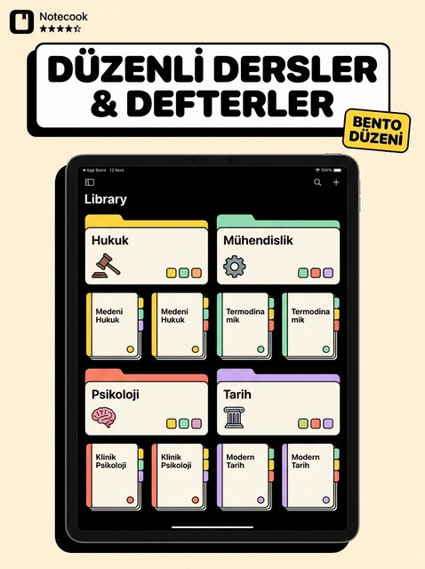
        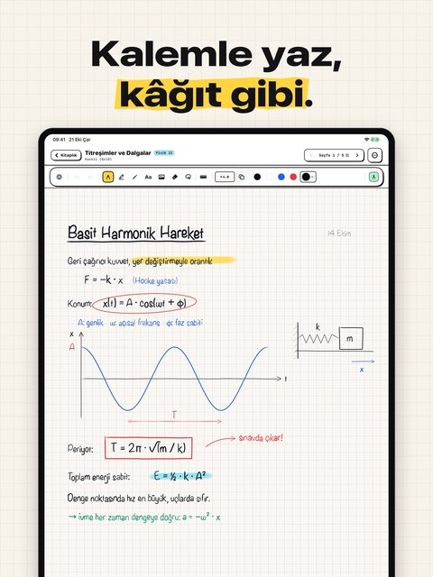
        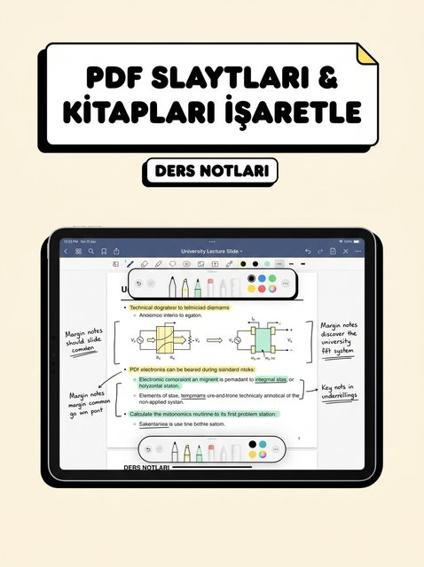
        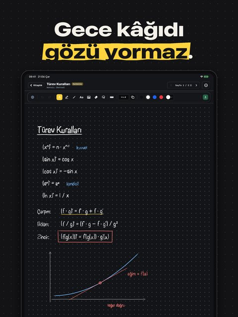
      

    </td>
  </tr>
  <tr>
    <td width="76" valign="top"><a href="https://apps.apple.com/tr/app/plainday/id6823780735">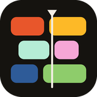</a></td>
    <td valign="top">
      <b><a href="https://apps.apple.com/tr/app/plainday/id6823780735">plainday</a></b> · <i>on the App Store</i> 
      Day planner that understands plain Turkish and English sentences. Widgets, alarms, Siri. 
      SwiftUI · SwiftData · AlarmKit · WidgetKit · 211 tests 
       
      

Screenshots
 
        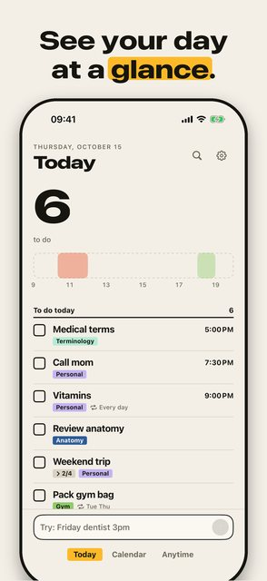
        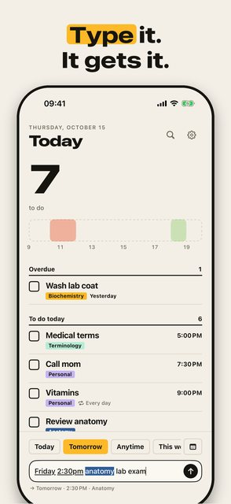
        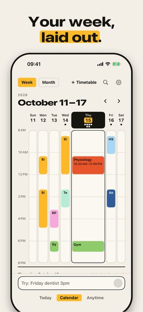
        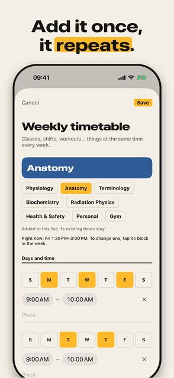
      

    </td>
  </tr>
  <tr>
    <td width="76" valign="top"><a href="https://apps.apple.com/tr/app/sweetspot-sakl%C4%B1-yerler/id6824031187">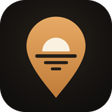</a></td>
    <td valign="top">
      <b><a href="https://apps.apple.com/tr/app/sweetspot-sakl%C4%B1-yerler/id6824031187">SweetSpot</a></b> · <i>on the App Store</i> 
      A map of quiet, little-known places, photographed on the spot, with a moderated backend. 
      SwiftUI · MapKit · Firebase · Cloud Functions 
       
      

Screenshots
 
        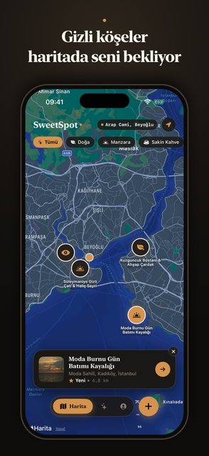
        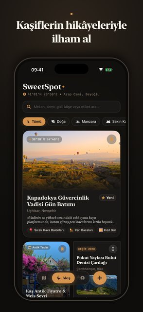
        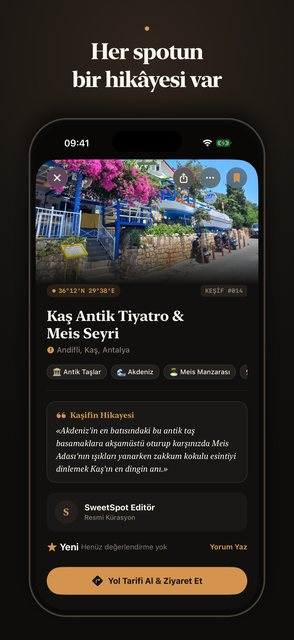
        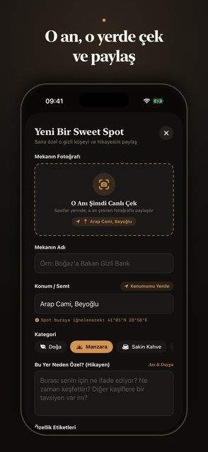
      

    </td>
  </tr>
  <tr>
    <td width="76" valign="top">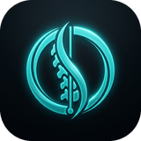</td>
    <td valign="top">
      <b>Fiziyoo</b> · <i>in development</i> 
      Clinic app for physiotherapists, with photo-based posture analysis that shows each measurement with its error band. 
      SwiftUI · SwiftData + CloudKit · Vision · Swift Charts · ~30k lines of Swift
    </td>
  </tr>
</table>

**Web**

<table>
  <tr>
    <td width="76" valign="top"></td>
    <td valign="top">
      <b><a href="https://www.85milyondabir.com.tr">85 Milyonda 1</a></b> · <i>live on the web</i> 
      A life simulation built on Turkey's real statistics. You're born at random, weighted by official TÜİK data, your life unfolds year by year, and you end up with a card to share. 
      Next.js · TypeScript · TÜİK data · next/og 
       
      

Share cards
 
        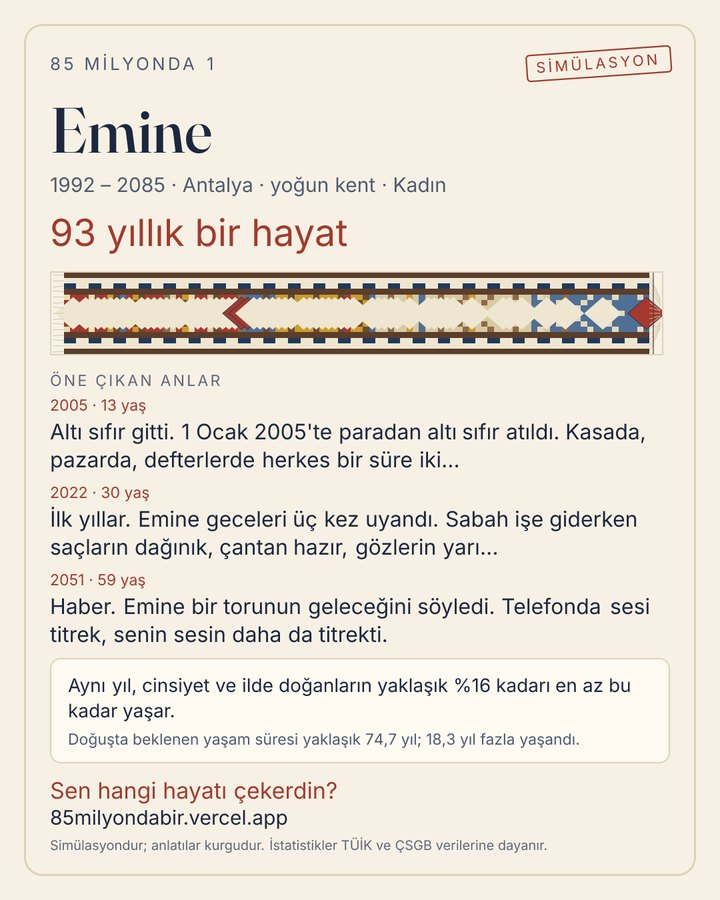
        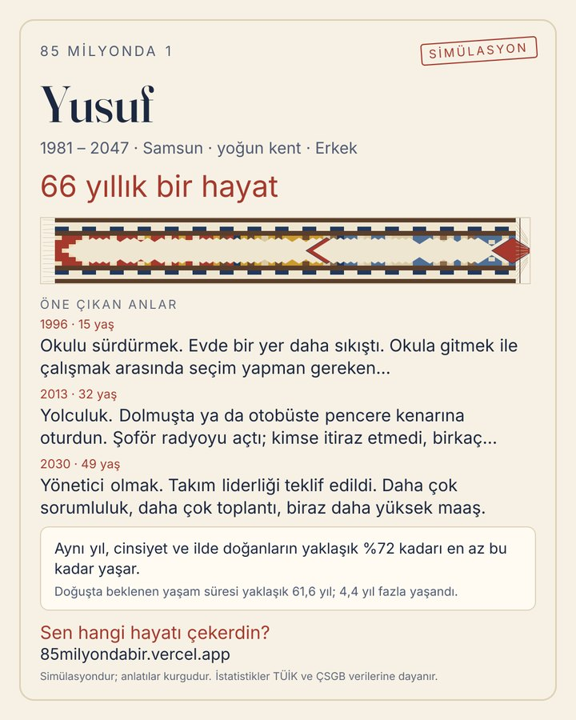
      

    </td>
  </tr>
</table>

**How I work**

I treat AI as a team I direct, not a magic box. You'll see Claude as co-author on my commits, and that's on purpose. I keep my own library of rules and skills (Swift 6 concurrency, SwiftData + CloudKit pitfalls, App Store review, UX audits) so every project starts from what the last one taught me.

**Stack**: Swift · SwiftUI · SwiftData · CloudKit · Vision · PencilKit · WidgetKit · App Intents · Firebase · React · Next.js · TypeScript · Capacitor

---

🇹🇷 Türkçe

 

Merhaba, ben Kerem. Üniversite öğrencisiyim, okulun yanında iOS uygulamaları ve web projeleri yapıyorum.

Portfolyom: **[kerem-sahin.github.io](https://kerem-sahin.github.io)**

- **App Store'da:** here. (aynı mekândaki insanlarla tanışma), notecook (iPad için el yazısı defteri), plainday (düz Türkçe cümleyle plan yapma) ve SweetSpot: Saklı Yerler (saklı yerlerin haritası)
- **Web'de:** [85 Milyonda 1](www.85milyondabir.com.tr) (Türkiye'nin gerçek istatistiklerine dayanan hayat simülasyonu)
- **Geliştiriliyor:** Fiziyoo (fizyoterapistler için klinik ve postür analizi uygulaması)
- **Açık kaynak:** PlainParse, "Cuma fizyoloji ödevi 18:00" gibi Türkçe cümleleri göreve çeviren Swift paketi

